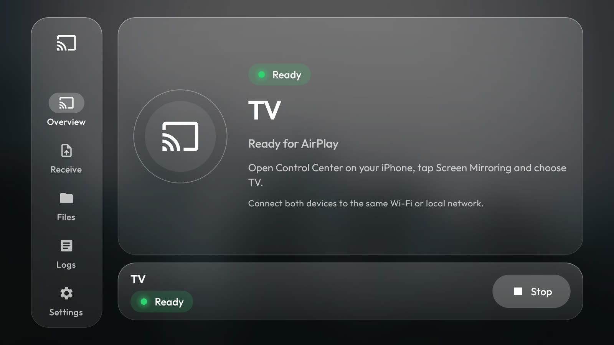
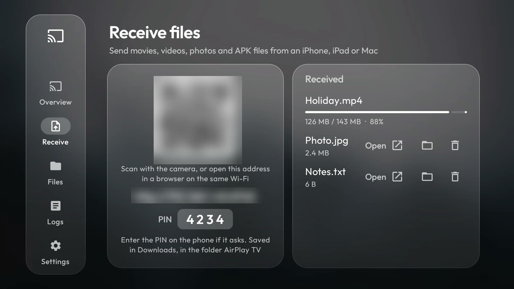
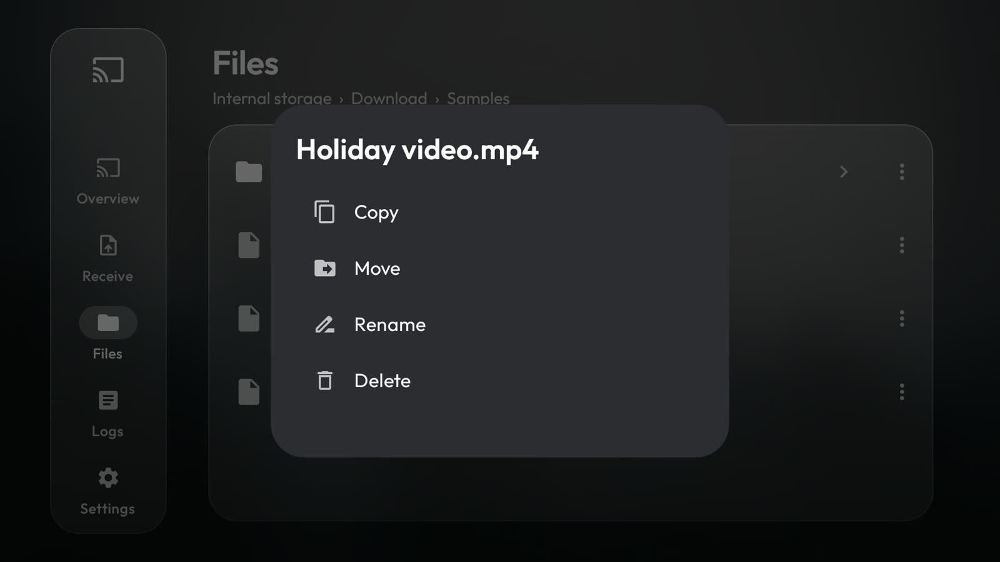
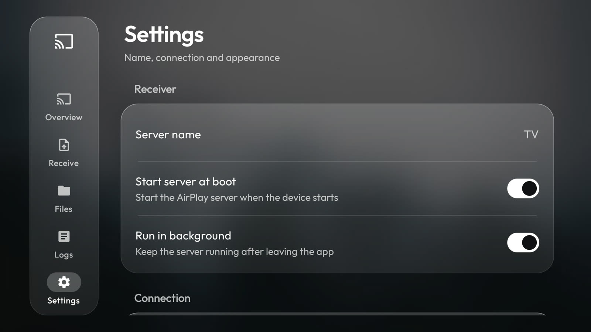

# AirPlay TV

Show your iPhone, iPad or Mac screen on an Android TV, with sound, using AirPlay. No Apple TV needed. It can also
receive files (movies, videos, photos, APK files) sent from a phone or computer, with nothing to install on the phone.

This repository has the receiver app (a clean, Apple-style Liquid Glass interface on an open-source AirPlay engine),
the installer scripts that put it on your TV, and a beginner guide. Mirroring settings that keep YouTube stable are
already built in.

<p>


</p>
<p>


</p>

> Not affiliated with Apple. "AirPlay" is a trademark of Apple Inc.

## What is in this repository

- **The app** (`app/`): a GPLv3 fork of [Shield AirPlay](https://github.com/ebreen/shield-airplay) by ebreen, which is
  built on [android-airplay-server](https://github.com/jqssun/android-airplay-server) by jqssun and
  [UxPlay](https://github.com/FDH2/UxPlay). The AirPlay engine is unchanged; this fork changes the interface and the
  defaults (see [CHANGES.md](CHANGES.md)). The signed app is on the [Releases](../../releases) page.
- **The installer** (`scripts/`): installs the app on the TV, grants the permissions it needs, checks it, removes it.
- **Guides** (`docs/`): install guide for beginners, settings explained, troubleshooting.

## What is different from the original app

- **New interface.** Frosted glass panels over a blurred wallpaper, Outfit font, light and dark themes. The option you
  have selected gets one soft highlight, nothing else. The status dot glows green when the receiver is ready or
  streaming, yellow while a device is connecting, and red when stopped or in error.
- **Minimal settings.** The first screen has only what most people need: the receiver name, start at boot, run in
  background, require a PIN, open on connect and the theme. Everything else is under **Advanced**.
- **Stable mirroring by default.** "Advertise AirPlay video support" is off out of the box (reason below).
- **Own app id** (`com.minimaltv.airplay`), so it installs next to the original. Do not run both at once: they use the
  same port.

## The problem this fixes

On the TV this was built on (a Xiaomi Mi TV, Android 10), mirroring from an iPhone worked, but opening **YouTube** on the
iPhone while mirroring made the session drop. YouTube tries to hand the video over to AirPlay directly, the receiver
could not do that, and the whole connection died. Telling the receiver not to advertise AirPlay *video* support, so the
iPhone keeps mirroring instead, fixed it. The app now ships with that setting off, so there is nothing to configure.
Details and what was ruled out: [docs/SETTINGS.md](docs/SETTINGS.md).

## Will it work on my TV?

| TV | Works? |
| --- | --- |
| Android TV or Google TV (Sony, TCL, Xiaomi, Philips, Hisense, Nvidia Shield, many others), Android 7 or newer | Should. Tested on **one** TV only: Xiaomi MiTV-MOOQ0, Android 10. Mirroring from an iPhone, including YouTube with sound, was tested on that TV with version 2.0.1; version 2.1.0 adds file receiving and browsing and leaves the mirroring engine unchanged. Receiving files was tested from an iPhone and a Mac browser, the Files tab with the remote |
| Fire TV | Probably, since it runs Android, but untested. Fire TV has its own adb switch under **Settings, My Fire TV, Developer options** |
| Samsung (Tizen), LG (webOS), Roku | No. They are not Android TV and cannot run this app. Many newer models already have AirPlay built in, check your TV's settings |

## Before you install (about 10 minutes)

Do this once. It gets the TV and your computer ready. More detail, other computers and fixes: the
[complete install guide](docs/INSTALL.md).

### Part 1: on the TV (use the remote)

| # | Do this | You should see |
| --- | --- | --- |
| 1 | Connect the TV to the **same Wi-Fi or router as your computer and your iPhone**: **Settings** (gear icon), **Network & Internet**, pick your Wi-Fi. Or plug in an Ethernet cable | "Connected" |
| 2 | **Settings**, **Network & Internet**, press OK on your network. **Write down the IP address** (like `192.168.1.50`). If you do not see it: **Settings, Device Preferences, About, Status** | four numbers with dots |
| 3 | **Settings**, **Device Preferences**, **About**. (Google TV: **Settings, System, About**) | the About list |
| 4 | Scroll to **Build** (it may be called **Build number**, **OS build** or **Android TV OS build**) and press **OK 7 times** | "You are now a developer!" |
| 5 | Press **Back** once and open **Developer options** | the Developer options list |
| 6 | Turn **USB debugging** to **ON** (if there is a switch called **Enable developer options**, make sure it is ON too). Turn on **Network debugging** or **Wireless debugging** as well if your TV has one | the switch shows ON |

### Part 2: on your computer (copy and paste)

Replace `YOUR_TV_IP` with the address you wrote down.

<details>
<summary><b>Windows 10 / 11</b></summary>

1. Open **PowerShell**: press the Windows key, type `PowerShell`, press Enter.
2. Copy both lines, paste them (right-click in the window), press Enter. This installs **Git** (with Git Bash) and
   Google's **adb**:
   ```powershell
   winget install --id Git.Git -e --source winget
   winget install --id Google.PlatformTools -e --source winget
   ```
3. **Close PowerShell.** Press the Windows key, type `Git Bash`, press Enter. The scripts run in **Git Bash**, not in
   PowerShell. Paste these lines (right-click to paste), press Enter:
   ```sh
   git clone https://github.com/AmalDamodar/airplay-tv.git
   cd airplay-tv
   adb connect YOUR_TV_IP:5555
   ```
4. Look at the TV: tick **Always allow from this computer** and choose **OK**. Then run `adb devices`. It must show
   your TV followed by the word **`device`**.

The Windows steps were not tested on a Windows PC; they use the official winget packages.
</details>

<details>
<summary><b>Mac</b></summary>

1. Open **Terminal**: press Cmd + Space, type `Terminal`, press Enter.
2. Install **Homebrew** (it installs the other tools). Paste this line, press Enter, type your Mac password if asked
   (you will not see it as you type). When it ends it prints **"Next steps"**: run the lines it shows, then close and
   reopen Terminal.
   ```sh
   /bin/bash -c "$(curl -fsSL https://raw.githubusercontent.com/Homebrew/install/HEAD/install.sh)"
   ```
3. Paste all of this, press Enter:
   ```sh
   brew install git
   brew install --cask android-platform-tools
   git clone https://github.com/AmalDamodar/airplay-tv.git
   cd airplay-tv
   adb connect YOUR_TV_IP:5555
   ```
4. If macOS asks to allow Terminal to find devices on your local network, click **Allow**. Look at the TV: tick
   **Always allow from this computer** and choose **OK**. Then run `adb devices`. It must show your TV followed by the
   word **`device`**.
</details>

Stuck? [Connection problems and what each message means](docs/INSTALL.md#if-the-connection-fails).

## Quick start

```sh
./scripts/install.sh            # downloads the receiver, checks it, installs it, sets permissions
```

That is all. Optional, on the TV with the remote: open the app, choose **Settings**, and change **Server name** (the
default is "TV") to what your iPhone should show, for example "Living Room".

Check it:

```sh
./scripts/check.sh
```

On the iPhone: **Control Center, Screen Mirroring, pick your TV's name.** Both devices must be on the same Wi-Fi.

## Send files to the TV

Open the **Receive** tab in the app. The TV shows a QR code, an address (like `http://192.168.1.50:8765`) and a 4-digit PIN.
On the iPhone, iPad or Mac, scan the code with the camera (or type the address in a browser on the same Wi-Fi), choose
the files and wait until each one says Done. They are saved on the TV in **Downloads, in the folder AirPlay TV**.
On the TV, the right side of the Receive tab lists what arrived. Each file has three buttons: **Open** (with an app on
the TV: a video in a video player, an APK in the system installer), **Show in folder** (jumps to the Files tab at that folder) and
**Delete**. Delete asks whether to delete the file from the TV or only remove it from the list.

- Nothing to install on the phone or computer: it is a web page served by the TV.
- Big files are fine: they are written straight to storage while they arrive (a 600 MB video was sent and compared
  byte for byte). Speed is limited by your Wi-Fi; about 7.5 MB/s on the test TV, so a 2 GB movie takes about 5 minutes.
- Only devices on your own network can connect, and every upload needs the PIN. Five wrong PINs lock that device out for
  a minute. The receiver runs only while the Receive tab is open (it also closes after 30 minutes without use).
- **Open** hands the file to whatever app on the TV can show it. If none can, you get a message. A TV usually has no
  gallery or document viewer, so photos and text files may need an app installed first. For an APK, Android asks once
  to allow installs from this app.

## Browse the TV's files

The **Files** tab is a small file manager made for the remote: internal storage and USB drives, folders first, in the
same glass style. **OK** opens a folder or a file (a video in a video player, an APK in the system installer),
**Back** goes up one level, and the **...** button to the right of a row offers **Copy**, **Move**, **Rename** and
**Delete**. Copy and Move wait for a destination: open that folder, then choose **Paste here**. Delete asks first (the
question starts on Cancel). The standard top-level folders (Download, DCIM, Android and so on) can only be copied. The first time,
choose **Allow access**.

On Android 10 TVs this works through the "legacy storage" setting. On Android 11 or newer the app needs the "all files
access" permission from the system settings, which some TVs do not offer; then the tab says so.

## What works, what does not

- Works (tested): mirroring with sound of YouTube, Shorts and other videos from an iPhone. Other apps and devices should behave the same, but were not tested.
- Does not work: DRM-protected video such as Netflix, Disney+ or Apple TV+ shows a black screen. This is Apple's copy
  protection, not a bug here.
- With video support off (the default), the small AirPlay button inside a video app sends **audio only**. Use **Control
  Center, Screen Mirroring** instead. That is the trade-off for stable mirroring. You can turn it back on in the app under
  Settings, Advanced, Compatibility.

## Scripts

| Script | What it does |
| --- | --- |
| `scripts/install.sh [tv-ip] [--apk file]` | Download, verify, install, grant permissions. Safe to run again |
| `scripts/check.sh [tv-ip]` | Read-only health check |
| `scripts/uninstall.sh [tv-ip]` | Remove the receiver and undo the permission changes |

More: [settings explained](docs/SETTINGS.md), [troubleshooting](docs/TROUBLESHOOTING.md),
[complete install guide](docs/INSTALL.md).

## Build from source

You need JDK 17 and the Android SDK (Gradle downloads the rest). The native AirPlay engine is not rebuilt by default;
its prebuilt libraries come from the official upstream release:

```sh
tools/fetch-native-libs.sh          # downloads, checks the checksum, unpacks the libraries
./gradlew :app:assembleDebug        # app/build/outputs/apk/debug/app-debug.apk
```

For a signed release put `storeFile`, `storePassword`, `keyAlias` and `keyPassword` in `local.properties`
(never commit it) and run `./gradlew :app:assembleRelease`. An app you sign with your own key installs fine, but it
cannot update, or be updated by, the one from the Releases page.

To compile the engine from source with the NDK instead, check out the submodules and pass `-PbuildNative`
(`git submodule update --init --recursive`, then `./gradlew :app:assembleRelease -PbuildNative`). This path was not
tested; upstream's [build notes](docs/UPSTREAM-README.md) and `SHIELD_BUILD.md` describe it.

## Legal

- Licence: GNU GPL v3, see [LICENSE](LICENSE). This covers the app and also the scripts and guides, which are the
  author's own. Complete corresponding source: this repository, plus the pinned submodules (UxPlay, FFmpeg, libplist,
  openssl-cmake) at the revisions in `SOURCE_REVISIONS.json`. The prebuilt native libraries in releases are the
  unmodified ones from upstream's `v2.0.1-shield` release.
- Upstream warns that UxPlay uses a reverse-engineered FairPlay compatibility component whose legal status is unclear.
  Check the laws that apply where you live.
- Fonts and images: see [NOTICE](NOTICE).
- Companion project for the rest of the TV (lighter home screen, safe debloat, remote buttons):
  [The MinimalTV Project](https://github.com/AmalDamodar/minimaltv). This one works on its own.
